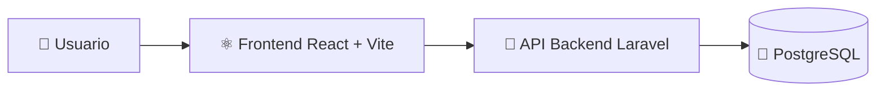

# 🏆 Olimpiadas UMSS – Plataforma de Inscripciones  
### Proyecto académico de Ingeniería de Software (TIS - CPTIS 4725)

<div align="left">


</div>

---

## 📌 Resumen ejecutivo

**Olimpiadas UMSS** es una plataforma web para la **gestión de inscripciones** a olimpiadas académicas.  
Este repositorio concentra principalmente el **frontend** construido con **React + Vite**, integrado a un backend por API.

✅ ¿Qué demuestra este proyecto a nivel profesional?

- 🧠 Diseño de interfaces modernas y usables.
- 🔌 Integración cliente-servidor mediante consumo de API.
- 📄 Exportación de datos y documentos (PDF/Excel).
- 🧱 Organización modular de componentes y páginas.
- ⚙️ Configuración de entorno y proceso de build para despliegue.

---

## 🧭 Tabla de contenido

- [🎯 Objetivo del proyecto](#-objetivo-del-proyecto)
- [🛠️ Stack tecnológico](#️-stack-tecnológico)
- [🏗️ Arquitectura general](#️-arquitectura-general)
- [✨ Funcionalidades principales](#-funcionalidades-principales)
- [📁 Estructura del repositorio](#-estructura-del-repositorio)
- [🚀 Configuración y ejecución local](#-configuración-y-ejecución-local)
- [🔐 Variables de entorno](#-variables-de-entorno)
- [📜 Scripts disponibles](#-scripts-disponibles)
- [💼 Aportes técnicos destacados](#-aportes-técnicos-destacados)
- [🔭 Líneas de mejora](#-líneas-de-mejora)
- [👨‍💻 Autor](#-autor)

---

## 🎯 Objetivo del proyecto

Digitalizar y optimizar el proceso de inscripción a olimpiadas académicas, permitiendo:

- 🧾 Registrar participantes (individual/grupal).
- 🧑‍🎓 Gestionar datos académicos y de contacto.
- 📊 Facilitar operaciones administrativas y consulta de información.
- 🔄 Integrar frontend con backend para persistencia y trazabilidad.

---

## 🛠️ Stack tecnológico

### 🎨 Frontend


### 📦 Librerías clave
- 📄 `jsPDF` + `jspdf-autotable` (reportes PDF)
- 📗 `ExcelJS` / `SheetJS` (exportación Excel)
- 🔍 `Tesseract.js` (OCR)
- 🔔 `react-hot-toast` (notificaciones)
- 🎯 `lucide-react` (iconografía UI)

### 🧠 Backend (referenciado en documentación del proyecto)


---

## 🏗️ Arquitectura general



- **Frontend:** interfaz, formularios, navegación y consumo API.  
- **Backend:** reglas de negocio, validación y endpoints REST.  
- **DB:** almacenamiento persistente de estudiantes, áreas e inscripciones.

---

## ✨ Funcionalidades principales

- 📝 Registro de inscripciones.
- 👥 Gestión de participantes y datos relacionados.
- 🧾 Generación de comprobantes.
- 📤 Exportación de reportes en PDF/Excel.
- 🔎 Consulta y organización de información por módulos.

---

## 📁 Estructura del repositorio

```text
.
├── frontend/
│   ├── public/
│   ├── src/
│   ├── .env.example
│   ├── package.json
│   ├── vite.config.js
│   └── README.md
├── project_analysis_summary.md
├── package.json
└── README.md
```

---

## 🚀 Configuración y ejecución local

### 1) Clonar repositorio

```bash
git clone https://github.com/fernando021099/TIS-CPTIS-4725-2025.git
cd TIS-CPTIS-4725-2025
```

### 2) Instalar dependencias

```bash
cd frontend
npm install
```

### 3) Configurar entorno

Crear `frontend/.env` tomando como base `frontend/.env.example`.

### 4) Levantar en desarrollo

```bash
npm run dev
```

---

## 🔐 Variables de entorno

```env
VITE_API_BASE_URL=<URL_BASE_DE_TU_API>
```

Ejemplo:

```env
VITE_API_BASE_URL=http://127.0.0.1:8000/api
```

---

## 📜 Scripts disponibles

- `npm run dev` → servidor de desarrollo.
- `npm run build` → build de producción.
- `npm run preview` → previsualización de build.

---

## 💼 Aportes técnicos destacados

Este proyecto refleja experiencia en:

- ✅ Desarrollo frontend moderno con React.
- ✅ Integración de APIs y flujo de datos.
- ✅ Exportación documental para casos administrativos.
- ✅ Arquitectura modular y mantenible.
- ✅ Preparación de entorno para colaboración técnica.

---

## 🔭 Líneas de mejora

- 🧪 Incorporar testing (unit/integration/e2e).
- 🚦 Implementar CI/CD.
- 📘 Documentar contratos API con OpenAPI/Swagger.
- 🔐 Reforzar seguridad y observabilidad.
- 🧩 Escalar manejo de estado global.

---

## 👨‍💻 Autor

**Fernando021099**  
🔗 Repositorio: https://github.com/fernando021099/TIS-CPTIS-4725-2025

---

## 🤝 Nota para reclutadores

Proyecto académico con enfoque práctico en resolución de problemas reales de gestión, integración full-stack y entrega de funcionalidades de valor para usuarios administrativos.
